# Quickstart & Mental Model

This guide introduces the `parsmith` data-flow mental model, walks through compiling and running a `.kdl` schema across all nine target backends (Python, TypeScript, JavaScript, Go, Rust, Elixir, PHP, C#, and Kotlin), and provides a decision matrix for choosing the right DSL construct.

---

## 1. The Mental Model

Imperative HTML scrapers and API wrappers interleave DOM traversal, string cleanup, regular expressions, type conversions, and error handling inside ad-hoc functions. When a selector or payload changes, failures only surface at runtime.

`parsmith` separates **schema declaration** from **target execution**. A `.kdl` file declares *what* data structure you want (`struct`, `json`, `fn`) and *how* each field is extracted through a strongly-typed **Pipeline**. The compiler validates selectors, regular expressions, imports, and step-by-step pipeline types at compile time (`parsmith check`), then emits a self-contained module with zero runtime dependency on `parsmith`.

### Data Flow

Every `parsmith` schema processes input through four stages:

```
Input (HTML DOM / Raw String / HTTP Response)
  -> Struct Kind (item, list, dict, table, flat, raw, rest, fn)
  -> Field Pipeline (Select -> Extract -> Transform -> Convert -> Fallback)
  -> Typed Output (TypedDict / dataclass / interface / Go struct / Rust struct)
```



```mermaid
flowchart LR
    subgraph Input["1. Input"]
        I1["HTML DOM (DOCUMENT)"]
        I2["Plain Text (STRING)"]
        I3["HTTP Response (@request)"]
    end

    subgraph Construct["2. Struct Kind"]
        K1["struct / (list)struct"]
        K2["(table)struct / (dict)struct / (flat)struct"]
        K3["(raw)struct / fn / (raw)fn"]
        K4["(rest)struct + @error"]
    end

    subgraph Pipeline["3. Field Pipeline"]
        direction LR
        P1["Select\ncss / xpath / @split-doc"] --> P2["Extract\ntext / attr / raw"]
        P2 --> P3["Transform\ntrim / re / split / filter"]
        P3 --> P4["Convert\nto-int / to-float / jsonify / nested"]
        P4 --> P5["Fallback\nfallback val / #null / {}"]
    end

    subgraph Output["4. Typed Output"]
        O1["Python (TypedDict / dataclass)"]
        O2["TypeScript (.ts) / JavaScript (.js + .d.ts)"]
        O3["Go (struct + gjson)"]
        O4["Rust (struct + serde)"]
    end

    Input --> Construct --> Pipeline --> Output
```

### How a Field Pipeline Works

Inside an HTML `struct`, each field pipeline begins with the current DOM node (`DOCUMENT`) and transforms it step by step:

```kdl
price {
    css ".price_color"      // DOCUMENT -> DOCUMENT (select element)
    text                    // DOCUMENT -> STRING   (extract text: "£51.77")
    re #"(\d+\.\d{2})"#     // STRING   -> STRING   (capture group 1: "51.77")
    to-float                // STRING   -> FLOAT    (parse float: 51.77)
    fallback 0.0            // FLOAT    -> FLOAT    (default on missing element or regex mismatch)
}
```

If any step receives an incompatible input type (for example, calling `trim` directly on a `DOCUMENT` before `text` or `attr`), `parsmith check` rejects the schema at compile time with `E100` (`TYPE_MISMATCH`).

---

## 2. Your First Schema (Step-by-Step)

Suppose you want to extract a catalog page title and a list of book cards from the following HTML document:

```html
<!DOCTYPE html>
<html>
  <body>
    <main class="catalog">
      <h1>Science Fiction &amp; Fantasy</h1>
      <article class="book-card" data-sku="BK-101">
        <h3><a href="/books/dune" title="Dune">Dune</a></h3>
        <p class="price">£18.50</p>
        <span class="stock">In stock</span>
      </article>
      <article class="book-card" data-sku="BK-102">
        <h3><a href="/books/neuromancer" title="Neuromancer">Neuromancer</a></h3>
        <p class="price">Out of print</p>
      </article>
    </main>
  </body>
</html>
```

### Step 1: Write `books.kdl`

Create `books.kdl`. Because `CatalogPage` references `BookCard` via `nested BookCard`, declare `BookCard` **above** `CatalogPage` (the intra-file top-down declaration order rule, `E302`):

```kdl
@doc "Book catalog scraper"

(list)struct BookCard {
    @split-doc { css-all "article.book-card" }

    sku { attr "data-sku" }
    title { css "h3 a"; attr "title"; trim }
    url { css "h3 a"; attr "href"; fmt "https://books.example.com{{}}" }
    price {
        css ".price"
        text
        re #"(\d+\.\d{2})"#
        to-float
        fallback #null
    }
    in_stock {
        css ".stock"
        text
        trim
        to-bool
        fallback #false
    }
}

struct CatalogPage {
    category { css "main.catalog h1"; text; trim }
    books { nested BookCard }
}
```

### Step 2: Validate the Schema (`parsmith check`)

Run `parsmith check` to validate KDL 2.0 syntax, CSS selectors, regular expressions, declaration order, and pipeline types:

```bash
parsmith check books.kdl
```

To also verify that no struct or field names collide with reserved keywords in specific target languages, pass `-t` / `--target`:

```bash
parsmith check books.kdl -t python -t typescript -t go -t rust
```

>[!tip]
>When integrating with CI pipelines or AI coding agents, pass `-f json` (`parsmith check books.kdl -f json`) to receive structured JSON diagnostics with 1-based line/column spans and actionable hints.

### Step 3: Generate Target Code (`parsmith generate`)

Compile `books.kdl` into any of the nine supported targets:

```bash
# Python 3.10+ (default: bs4 + TypedDict; also supports -L lxml|parsel|selectolax and --models dataclass)
parsmith generate python books.kdl -o catalog.py

# Standalone TypeScript (.ts)
parsmith generate ts books.kdl -o catalog.ts

# ESM JavaScript (.js) + companion TypeScript declarations (.d.ts)
parsmith generate js books.kdl -o catalog.js

# Go 1.26+ (goquery; customizable package name via --package)
parsmith generate go books.kdl --package catalog -o catalog.go

# Rust (dom_query + serde)
parsmith generate rust books.kdl -o catalog.rs

# Elixir 1.18–1.20+ on Erlang/OTP 27–29 (Floki + built-in JSON + OTP :httpc)
parsmith generate elixir books.kdl -o catalog.ex

# PHP 8.1+ (default: zero-Composer native DOMDocument + DOMXPath; or --html-lib dom-crawler)
parsmith generate php books.kdl -o catalog.php

# C# / .NET 8+ (AngleSharp + System.Text.Json + HttpClient)
parsmith generate csharp books.kdl -o Catalog.cs

# Kotlin / JVM (Jsoup + kotlinx.serialization.json + java.net.http.HttpClient)
parsmith generate kotlin books.kdl -o Catalog.kt
```

### Step 4: Invoke the Generated Parser

Every generated module exposes a consistent, idiomatic entry point for `CatalogPage`:

#### Python

```python
from catalog import CatalogPage, CatalogPageType

result: CatalogPageType = CatalogPage(html).parse()
print(result["category"])       # "Science Fiction & Fantasy"
print(result["books"][0]["sku"]) # "BK-101"
print(result["books"][1]["price"]) # None (fallback #null triggered)
```

#### TypeScript / JavaScript

```typescript
import { CatalogPage, type CatalogPageType } from "./catalog";

const result: CatalogPageType = new CatalogPage(html).parse();
console.log(result.category);        // "Science Fiction & Fantasy"
console.log(result.books[0].sku);    // "BK-101"
console.log(result.books[1].price);  // null
```

#### Go

```go
package main

import (
	"fmt"
	"log"

	"example.com/catalog"
)

func main() {
	parser, err := catalog.NewCatalogPage(html)
	if err != nil {
		log.Fatal(err)
	}
	result := parser.Parse()
	fmt.Println(result.Category)        // "Science Fiction & Fantasy"
	fmt.Println(result.Books[0].Sku)    // "BK-101"
	fmt.Println(result.Books[1].Price)  // <nil> (*float64)
}
```

#### Rust

```rust
mod catalog;
use catalog::{CatalogPageParser as CatalogPage, CatalogPageType};

fn main() -> Result<(), catalog::RtError> {
    let result: CatalogPageType = CatalogPage::new(html)?.parse()?;
    println!("{}", result.category);        // "Science Fiction & Fantasy"
    println!("{}", result.books[0].sku);    // "BK-101"
    println!("{:?}", result.books[1].price); // None (Option<f64>)
    Ok(())
}
```

>[!note]
>In Rust, each HTML or `(raw)` struct `Name` generates the output data struct `NameType` and the stateful parser `NameParser` (`NameParser::new(html)?.parse()?`), whereas a `(rest)struct Name` generates `Name` (along with the alias `NameParser = Name`) where `Name::new()` constructs the client directly.

### Extracted Output Shape

Across all five targets, parsing the sample HTML produces the exact same data structure:

```json
{
  "category": "Science Fiction & Fantasy",
  "books": [
    {
      "sku": "BK-101",
      "title": "Dune",
      "url": "https://books.example.com/books/dune",
      "price": 18.5,
      "in_stock": true
    },
    {
      "sku": "BK-102",
      "title": "Neuromancer",
      "url": "https://books.example.com/books/neuromancer",
      "price": null,
      "in_stock": false
    }
  ]
}
```

---

## 3. Decision Matrix ("Which Construct Do I Need?")

Use this table to select the right top-level declaration for your extraction task:

| Extraction Goal | DSL Construct | Required Directives | Input Type | Return Type (`Python` / `TS` / `Go` / `Rust`) |
| :--- | :--- | :--- | :--- | :--- |
| **Single HTML object** (product detail page, article header, page wrapper) | `struct Name` or `(item)struct Name` | *(none)* (1+ regular fields) | `DOCUMENT` | `NameType` / `NameType` / `NameType` / `NameType` |
| **Repeating HTML cards or rows** (search results, product grids, feed items) | `(list)struct Name` | `@split-doc` | `DOCUMENT` | `list[NameType]` / `NameType[]` / `[]NameType` / `Vec<NameType>` |
| **HTML specification table** where rows are matched by header cell text (`<th>` $\to$ `<td>`) | `(table)struct Name` | `@table`, `@rows`, `@match`, `@value` (fields start with `match { ... }`) | `DOCUMENT` | `NameType` (`TypedDict` or `dataclass`) / `NameType` / `map[string]any` / `HashMap<String, Value>` |
| **Dynamic key-value map** from repeating DOM elements (`<meta name="..." content="...">`) | `(dict)struct Name` | `@split-doc`, `@key`, `@value` *(no regular fields)* | `DOCUMENT` | `dict[str, V]` / `Record<string, V>` / `map[string]V` / `HashMap<String, V>` |
| **Deduplicated flat list of strings** from one or more selectors (tag clouds, pagination links) | `(flat)struct Name [keep-order=#true]` | *(none)* (fields must return `STR` or `STR[]`) | `DOCUMENT` | `list[str]` / `string[]` / `[]string` / `Vec<String>` |
| **Single value from HTML** without wrapping it in a struct or class | `fn name` | *(none)* *(struct directives forbidden)* | `DOCUMENT` | Scalar or array return type inferred from pipeline |
| **Single value from plain text** (regex token extraction from JS/headers/URLs) | `(raw)fn name` | *(none)* *(HTML ops & struct directives forbidden)* | `STRING` | Scalar or array return type inferred from pipeline |
| **Structured object or list from plain text** (inline `<script>`, M3U8 playlists, query strings, logs) | `(raw)struct Name` | *(none)* (`@split-doc` optional: omit for `ITEM`, include for `LIST`; HTML ops forbidden) | `STRING` | `NameType` (no `@split-doc`) or `list[NameType]` / `NameType[]` / `[]NameType` / `Vec<NameType>` (with `@split-doc`) |
| **Embedded JSON inside HTML or text** (`__NEXT_DATA__`, `application/ld+json`, JS variables) | `json Schema` + `jsonify Schema [path="..."]` | Declared `json` / `(array)json` / `(dict)json` above caller | `STRING` / `STRING[]` | Projected `SchemaJson` (or array/dict of `SchemaJson`) via strict allowlist projector |
| **Typed HTTP / REST API client** with status/field error discrimination | `(rest)struct Name` | 1+ `@request` with `name="..."` and `response="..."` (optional `@error[:<suffix>]`) | HTTP `SyncTransport` / `AsyncTransport` / `*http.Client` / `&reqwest::Client` | Monadic `Result` (`Ok[T]` \| `<Struct>Err<Status>[<Suffix>]` \| `DecodeErr` \| `UnknownErr` \| `TransportErr`) |

## Next Steps

- Continue to [Syntax & File Structure (`syntax.md`)](syntax.md) to learn KDL 2.0 rules, all seven struct kinds in detail, `@init` / `@pre-validate` / `@check` directives, `define` constants and blocks, and multi-file `import` resolution.
- Explore [Pipeline Operations (`operations.md`)](operations.md) and [Condition Expressions (`conditions.md`)](conditions.md) for the full list of transformations and filters.
