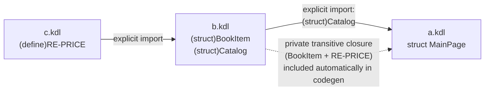

# Syntax & File Structure

This guide covers the KDL 2.0 syntax used by `parsmith` (DSL v2.1), the seven `struct` kinds, module-level functions (`fn`, `(raw)fn`), struct directives (`@doc`, `@init`, `@pre-validate`, `@check`), reusable constants and blocks (`Scalar define`, `Block define`), and multi-file modularity (`import` and intra-file declaration order `E302`).

---

## 1. KDL 2.0 Crash Course for `parsmith`

`parsmith` schemas are valid [KDL 2.0](https://kdl.dev/) documents. Every construct in the language—from top-level `struct` and `json` declarations down to individual pipeline steps—is a KDL node.

### Node Anatomy

A KDL 2.0 node has four optional parts around its name:

```kdl
(type-tag)node-name "positional-arg" key="property-val" {
    child-node "arg"
}
```

1. **Type annotation (`(type-tag)`)**: A prefix in parentheses attached directly to the node name with no whitespace, such as `(list)struct`, `(raw)fn`, `(array)json`, or `(struct)BookCard`.
2. **Node name (`node-name`)**: The declaration, field, directive, or operation identifier (`struct`, `title`, `@split-doc`, `css`, `!Utils.slugify`).
3. **Positional arguments & `key=value` properties**: Space-separated arguments (`".price"`, `0`, `#true`) and named properties (`keep-order=#true`, `from="data.id"`).
4. **Children block (`{ ... }`)**: Nested child nodes representing struct fields, pipeline steps, or condition expressions.

### Single-Line `;` Pipelines vs Multi-Line Blocks

In KDL 2.0, child nodes inside `{ ... }` are separated either by **newlines** or by **semicolons (`;`)**. A trailing semicolon on the last node in a block is optional.

Both forms below compile to the exact same pipeline:

```kdl
struct Article {
    // Compact single-line pipeline separated by semicolons
    title { css "h1.headline"; text; trim }

    // Multi-line block pipeline separated by newlines
    summary {
        css "p.lead"
        text
        normalize-space
        fallback #null
    }
}
```

>[!warning]
>Adjacent operations on the same line **must** be separated by `;`. Writing `title { css "h1" text }` without a semicolon passes `text` as a second positional argument to `css`, triggering `E001` (`INVALID_ARGUMENT_COUNT`).

### Quoted, Raw (`#"..."#`), and Multi-Line Strings (`#"""..."""#`)

KDL 2.0 provides three string literal styles, each suited to a different part of a schema:

1. **Standard quoted strings (`"..."`)**: Use for CSS/XPath selectors, attribute names, and delimiters (`"\n"`, `"\t"`). Backslashes require escaping (`"\\"`).
2. **Raw strings (`#"..."#`)**: Backslashes are treated literally with **zero escaping**. Always prefer `#"..."#` for regular expressions and GJSON paths with escaped dots (`from=#"meta.item\.id"#`). If your regex contains `"#`, widen the delimiter to `##"..."##`.
3. **Multi-line raw strings (`#"""..."""#`)**: Opening `#"""` must be followed immediately by a newline, and closing `"""#` must sit on its own line. Leading indentation matching the closing `"""#` line is automatically stripped by KDL 2.0. Use `#"""..."""#` for verbose `(?x)` regular expressions and multi-line `@request` templates.

```kdl
define PRICE-RE=#"""
(?x)
    £\s*
    (\d+\.\d{2})   # capture group 1: numeric price
"""#

struct Offer {
    // Raw string avoids double-escaping \d and \.
    code { css ".sku"; text; re #"SKU-(\d+)"# }
    price { css ".price"; text; re PRICE-RE; to-float }
}
```

### Boolean and Null Literals (`#true`, `#false`, `#null`)

KDL 2.0 prefixes boolean and null keywords with `#`:

- `#true` — boolean true (`keep-order=#true`, `fallback #true`)
- `#false` — boolean false (`fallback #false`, `success=#false`)
- `#null` — null literal (`fallback #null`, `response=#null`)

>[!warning]
>Bare `true`, `false`, and `null` without a leading `#` are invalid in KDL 2.0 and fail with `E000` (`SYNTAX_ERROR`). Always write `#true`, `#false`, and `#null`.

### Line Continuation (`\`) and the `//` Comment Trap

Long nodes can be wrapped across lines using a trailing backslash (`\`).

```kdl
struct Item {
    price {
        css ".price" \
            ; text \
            ; to-float
    }
}
```

>[!warning]
>**Never place a `//` comment on the same line after a `\` continuation inside a multi-line string or node.** In KDL 2.0, `//` consumes everything up to and including the newline character, which cancels the `\` escape and splits the node or `@request` string in half (`E000` / `E203`). Place comments on separate lines above the node, or use `#"""..."""#` multi-line raw strings for `@request` blocks.

---

## 2. Structs (`struct` and `(kind)struct`)

A `struct` defines a parser class/type and its output data shape. `parsmith` supports **seven struct kinds**, specified via the canonical prefix tag `(kind)struct Name`:

```kdl
(list)struct BookCard {
    @split-doc { css-all ".book" }
    title { css "h3"; text; trim }
}
```

>[!note]
>Omitting the prefix tag (`struct Name { ... }`) defaults to `(item)struct`. Legacy property syntax (`struct Name type="list" { ... }`) is accepted for backward compatibility, but prefix annotation `(kind)struct` is canonical.

### Summary of Struct Kinds

| Struct Kind | Declaration | Required Directives (`E401`) | Regular Fields | Parsed Return Type (`Python` / `TS` / `Go` / `Rust`) |
| :--- | :--- | :--- | :--- | :--- |
| **Item** *(default)* | `struct Name` / `(item)struct Name` | *(none)* | 1+ required | `NameType` / `NameType` / `NameType` / `NameType` |
| **List** | `(list)struct Name` | `@split-doc` | 1+ required | `list[NameType]` / `NameType[]` / `[]NameType` / `Vec<NameType>` |
| **Dict** | `(dict)struct Name` | `@split-doc`, `@key`, `@value` | **Forbidden (`E203`)** | `dict[str, V]` / `Record<string, V>` / `map[string]V` / `HashMap<String, V>` |
| **Table** | `(table)struct Name` | `@table`, `@rows`, `@match`, `@value` | 1+ required (must start with `match { ... }`, `E203`) | `NameType` / `NameType` / `map[string]any` / `HashMap<String, Value>` |
| **Flat** | `(flat)struct Name [keep-order=#true]` | *(none)* | 1+ required (must return `STR` or `STR[]`) | `list[str]` / `string[]` / `[]string` / `Vec<String>` |
| **Raw** | `(raw)struct Name` | *(none)* (`@split-doc` optional) | 1+ required (HTML ops forbidden, `E203`) | `NameType` (no `@split-doc`) or list of `NameType` (with `@split-doc`) |
| **REST** | `(rest)struct Name` | 1+ `@request` (`name=` & `response=`) | **Forbidden (`E203`)** | Monadic `Result` per endpoint method |

---

### 2.1 `struct` / `(item)struct` — Single HTML Object

Extracts a single typed record from an HTML document or DOM fragment.

```kdl
struct ProductDetail {
    title { css "h1.product-title"; text; trim }
    sku { css "[data-sku]"; attr "data-sku" }
    price { css ".price"; text; re #"(\d+\.\d{2})"#; to-float; fallback #null }
}
```

---

### 2.2 `(list)struct` — Repeating HTML Items

Splits the input document into repeating DOM elements using `@split-doc` (`DOC -> DOC[]`) and runs every regular field pipeline once per element (`DOC`).

```kdl
(list)struct SearchResult {
    @split-doc { css-all "ul.results > li.result-item" }

    title { css "h2 a"; text; trim }
    href { css "h2 a"; attr "href" }
    snippet { css "p.summary"; text; normalize-space; fallback "" }
}
```

---

### 2.3 `(dict)struct` — Dynamic Key-Value Map

Extracts a dictionary from repeating elements using `@split-doc`, `@key` (`DOC -> STR`), and `@value` (`DOC -> Any`). Regular named fields are forbidden inside `(dict)struct` (`E203`).

```kdl
(dict)struct PageMeta {
    @split-doc { css-all "head meta[name]" }
    @key { attr "name"; lower }
    @value { attr "content"; fallback #null }
}
```

---

### 2.4 `(table)struct` — Key-Matched HTML Table

Extracts structured fields from HTML `<table>` layouts where rows are identified by header text rather than fixed row indices.

A `(table)struct` requires four directives:
- `@table`: Selects the table container (`DOC -> DOC`).
- `@rows`: Selects row elements inside `@table` (`DOC -> DOC[]`).
- `@match`: Extracts the comparison key string from each row (`DOC -> STR`).
- `@value`: Extracts the raw cell value from a matched row (`DOC -> STR`).

Every regular field in a `(table)struct` **must** begin with `match { <cond> }` (`E203`) (unless the field is a single `nested` call). When `match` succeeds on a row's `@match` key, the remainder of the field pipeline transforms that row's `@value` string:

```kdl
(table)struct ProductSpecs {
    @table { css "table.product-specs" }
    @rows { css-all "tr" }
    @match { css "th"; text; trim; lower }
    @value { css "td"; text; trim }

    upc {
        match { eq "upc" }
    }
    price_excl_tax {
        match { starts "price (excl" }
        re #"(\d+\.\d{2})"#
        to-float
        fallback 0.0
    }
    review_count {
        match { contains "reviews" }
        re #"(\d+)"#
        to-int
        fallback 0
    }
}
```

---

### 2.5 `(flat)struct` — Deduplicated String List

Collects `STRING` and `STRING[]` results across one or more fields into a single flat array of unique strings. Pass `keep-order=#true` on the struct declaration to preserve first-seen insertion order across all targets.

```kdl
(flat)struct PageLinks keep-order=#true {
    nav_links { css-all "nav a[href]"; attr "href" }
    footer_links { css-all "footer a[href]"; attr "href" }
}
```

---

### 2.6 `(raw)struct` — Plain-Text Extraction (No HTML Parser)

`(raw)struct` operates directly on a `STRING` input without invoking an HTML DOM parser (`bs4`, `lxml`, `parsel`, `selectolax`, `DOMParser`, `goquery`, or `dom_query`). Use it for JavaScript source files, M3U8 playlists, URL query strings, HTTP headers, or log files.

Key rules for `(raw)struct`:
- **Initial pipeline input is `STRING`**: Field pipelines begin immediately with string, regex, JSON, or control operations (`re`, `re-all`, `split`, `trim`, `jsonify`, etc.).
- **HTML operations are forbidden (`E203`)**: Using `css`, `css-all`, `css-remove`, `xpath`, `xpath-all`, `xpath-remove`, `text`, `attr`, or `raw` inside a `(raw)struct` fails compilation with `E203`.
- **Automatic `ITEM` vs `LIST` mode**:
  - Without `@split-doc`, `(raw)struct` returns a single object (`ITEM`).
  - With `@split-doc` (`STRING -> STRING[]`), `(raw)struct` iterates over each split string and returns a list of objects (`LIST`).
- **Supports struct directives**: `@doc`, `@init`, `@pre-validate`, `@check`, and `@request` (`fetch` passes the HTTP response body directly as a raw `STRING`).

```kdl
// ITEM mode (no @split-doc): returns a single PlayerConfigType object
(raw)struct PlayerConfig {
    @doc "Extract stream URL and poster from an inline Playerjs script."

    stream_url { re #"file\s*:\s*["']([^"']+\.m3u8)["']"# }
    poster_url { re #"poster\s*:\s*["']([^"']+)["']"#; fallback #null }
}

// LIST mode (@split-doc present): returns a list of StreamVariantType objects
(raw)struct StreamVariant {
    @split-doc {
        split "\n"
        filter { starts "https://" }
    }

    url { trim }
    resolution { re #"/(\d+p)/"#; fallback "unknown" }
}
```

---

### 2.7 `(rest)struct` — Typed HTTP / REST API Client

`(rest)struct` generates a standalone HTTP client for JSON/REST endpoints with typed request parameters (`{{name:type[]?|style}}`), strict allowlist JSON response projection, and status/field **Error discriminators** (`@error[:<suffix>]`).

A `(rest)struct` body allows **only** `@doc`, `@request` (requiring `name="..."` and `response="..."`), and `@error[:<suffix>]` directives (`E203`).

```kdl
json UserProfile {
    id int
    username str
}

json ApiErrorBody {
    code str
    message str
}

(rest)struct UserApi {
    @doc "Typed client for the User service"

    @request name="get-user" response="UserProfile" \
        "curl https://api.example.com/v1/users/{{user_id:int}}"

    @error:not-found 404 ApiErrorBody code="USER_NOT_FOUND"
}
```

See [HTTP Requests & REST Clients (`http-rest.md`)](http-rest.md) for the complete `(rest)struct`, `@error[:<suffix>]`, `DecodeErr`, and `via_*` transport guide.

---

## 3. Module-Level Functions (`fn` and `(raw)fn`)

When you only need to extract a single scalar or list value without defining a full `struct` model, declare a module-level function with `fn` (HTML `DOCUMENT` input) or `(raw)fn` (plain-text `STRING` input).

```kdl
fn canonical_url {
    @doc "Extract <link rel='canonical'> href from an HTML document."
    css "link[rel='canonical']"
    attr "href"
    trim
    fallback #null
}

(raw)fn extract_bearer_token {
    @doc "Extract Bearer token from an Authorization header string."
    re #"Bearer\s+([A-Za-z0-9._~+/-]+=*)"#
}
```

### Rules & Target Naming Conventions

- **Body**: A single pipeline (identical to a `struct` field body), plus an optional `@doc "..."` directive.
- **Forbidden directives (`E203`)**: Struct-only directives (`@init`, `@pre-validate`, `@check`, `@split-doc`, `@key`, `@value`, `@table`, `@rows`, `@match`, `@request`, `@error`) are rejected inside `fn` and `(raw)fn`.
- **No HTML ops in `(raw)fn` (`E203`)**: Like `(raw)struct`, `(raw)fn` starts with `STRING` and forbids `css*`, `xpath*`, `text`, `attr`, and `raw`.
- **Generated function names** follow each target's native naming convention:

| KDL Declaration | Python (`python`) | TypeScript / JS (`ts` / `js`) | Go (`go`) | Rust (`rust`) |
| :--- | :--- | :--- | :--- | :--- |
| `fn canonical_url` | `def canonical_url(document) -> str \| None` | `export function canonicalUrl(document): string \| null` | `func CanonicalUrl(input string) (*string, error)` | `pub fn canonical_url(document: impl Into<String>) -> Result<Option<String>, rt::RtError>` |
| `(raw)fn extract_bearer_token` | `def extract_bearer_token(document: str) -> str` | `export function extractBearerToken(document: string): string` | `func ExtractBearerToken(input string) string` | `pub fn extract_bearer_token(document: impl Into<String>) -> Result<String, rt::RtError>` |

---

## 4. Struct Directives

Directives inside a `struct` are prefixed with `@` and configure documentation, precomputation, validation, structural splitting, or HTTP fetching.

### 4.1 `@doc` — Documentation Comments

`@doc "<text>"` attaches a docstring or doc comment to the **module root**, a **`struct`**, or a **`fn`**. Multi-line strings are supported.

```kdl
@doc """
Catalog scraping module.
Generated by parsmith.
"""

struct BookItem {
    @doc "Extracts a single book entry."
    title { css "h1"; text; trim }
}
```

>[!note]
>Inside a regular field pipeline (`title { ... }`), `@<name>` refers to a **Precomputed field** from `@init` (not `@doc`). Use standard KDL `//` comments to annotate individual fields.

---

### 4.2 `@init` — Precomputed Fields (`@<name>`)

`@init` declares one or more **Precomputed fields** that are evaluated once when the parser instance is initialized and cached on `self`. Regular fields reference a precomputed value as the **first step** of their pipeline using `@<name>`:

```kdl
json AppState {
    build_id str
    locale str
}

struct NextPage {
    @init {
        next_json {
            css "script#__NEXT_DATA__"
            text
            jsonify AppState
        }
        header_box {
            css "header.site-header"
        }
    }

    title { @header_box; css "h1"; text; trim }
    subtitle { @header_box; css "p.tagline"; text; trim; fallback #null }
    state { @next_json }
}
```

Rules for `@init`:
- `@<name>` must be the **first** operation in a field pipeline (`E203` if placed mid-pipeline).
- Referencing an undeclared `@<name>` raises `E301` (`UNDEFINED_INIT_FIELD`).
- Legacy `self <name>` syntax is rejected with `E203`; always use `@<name>`.

---

### 4.3 `@pre-validate` — Pre-Parse Document Validation

`@pre-validate` runs one or more `assert` steps against the root input at the start of `parse()`, before any field pipelines execute. If an assertion fails without a `fallback`, parsing aborts immediately with `RtAssertionError` (`rt::RtError` in Rust).

```kdl
struct ArticlePage {
    @pre-validate {
        assert "Expected an article page with <article.post>" {
            css "article.post"
        }
    }

    headline { css "article.post h1"; text; trim }
}
```

---

### 4.4 `@check` — Public Boolean Check Methods

`@check <name> { <pipeline> }` generates a standalone boolean method on the parser class so callers can inspect page state (for example, checking whether a captcha or pagination next-button exists) before or without calling `parse()`.

```kdl
struct SearchPage {
    @check is-empty-result {
        css ".no-results-banner"
        to-bool
        fallback #false
    }

    @check has-next-page {
        css "a.pagination-next[href]"
        to-bool
        fallback #false
    }

    heading { css "h1"; text; trim }
}
```

Rules for `@check`:
- Requires a method name argument (`@check <name> { ... }`, `E001`).
- The pipeline output **must** be `BOOL` (typically ending with `to-bool` or `to-bool; fallback #false`, `E100`).
- Multiple `@check` declarations per struct are allowed as long as their names are unique (`E402`).
- Generated method names follow target conventions (`search_page.is_empty_result()` in Python and Rust, `searchPage.isEmptyResult()` in TS/JS, `searchPage.IsEmptyResult()` or camel/Pascal receiver method in Go).

---

### 4.5 Structural Directives Summary

| Directive | Allowed Struct Kinds | Arity & Signature | Purpose |
| :--- | :--- | :--- | :--- |
| `@doc` | module root, all `struct` kinds, `fn`, `(raw)fn` | `@doc "<description>"` | Emits module, class/struct, or function documentation |
| `@init` | `item`, `list`, `dict`, `table`, `flat`, `raw` | `@init { <name> { <pipeline> }; ... }` | Precomputes and caches values on the parser instance for `@<name>` references |
| `@pre-validate` | `item`, `list`, `dict`, `table`, `flat`, `raw` | `@pre-validate { assert ["<msg>"] { <cond> } }` | Validates input before `parse()`, raising `RtAssertionError` on failure |
| `@check` | `item`, `list`, `dict`, `table`, `flat`, `raw` | `@check <name> { <pipeline -> BOOL> }` | Emits a boolean inspection method on the parser |
| `@split-doc` | `list`, `dict`, `raw` | `@split-doc { <pipeline -> DOC[] \| STR[]> }` | Splits input into repeating elements or text chunks |
| `@key` | `dict` | `@key { <pipeline -> STR> }` | Extracts dictionary key from each split item |
| `@value` | `dict`, `table` | `@value { <pipeline> }` | Extracts dictionary value (`dict`) or table cell text (`table`) |
| `@table` | `table` | `@table { <pipeline -> DOC> }` | Selects the root `<table>` element |
| `@rows` | `table` | `@rows { <pipeline -> DOC[]> }` | Selects row elements inside `@table` |
| `@match` | `table` | `@match { <pipeline -> STR> }` | Extracts the row header string compared by field `match { ... }` blocks |
| `@request` | all `struct` kinds | `@request [props] "<curl_or_http>"` | Generates HTTP `fetch` / `async_fetch` constructors or `(rest)struct` endpoint methods |
| `@error[:<suffix>]` | `rest` only | `@error[:<suffix>] <status> <Schema> [keys...] [k=v...]` | Maps HTTP error responses to typed `<Struct>Err<Status>[<Suffix>]` variants |

---

## 5. Reuse with `define` (`Scalar define` & `Block define`)

`define` eliminates repetition across fields, JSON schemas, and HTTP requests through compile-time substitution.

### Mandatory `UPPER_CASE` Naming (`E002`)

Every `define` identifier **must** be `UPPER_CASE` matching `^[A-Z_][A-Z0-9_-]*$` (letters `A-Z`, digits `0-9`, underscores `_`, and hyphens `-`). Lowercase or mixed-case names (`define base_url="..."` or `define BaseUrl="..."`) are rejected with `E002`.

### 5.1 Scalar Define (`define KEY="value"`)

A **Scalar define** binds one or more `UPPER_CASE` constants to string, integer, float, or boolean literals:

```kdl
define BASE-URL="https://books.example.com"
define API-V1="{{BASE-URL}}/api/v1"
define RE-PRICE=#"(\d+\.\d{2})"#

struct BookLink {
    url { css "a.book"; attr "href"; fmt "{{BASE-URL}}{{}}" }
    price { css ".price"; text; re RE-PRICE; to-float }
}
```

Rules for **Scalar define**:
- **Argument substitution**: Passing `RE-PRICE` as an operation argument (`re RE-PRICE`) or `@request` argument (`@request SEARCH-REQ`) substitutes its literal value at compile time.
- **Compile-time `{{UPPER_NAME}}` interpolation**: Inside a scalar `define` string or `fmt` template, `{{BASE-URL}}` is replaced at compile time with the value of `BASE-URL`.
- **Lowercase `{{param}}` vs `{{UPPER_NAME}}`**: Lowercase placeholders (`{{page:int}}`, `{{query:str?}}`) are preserved untouched by `define` interpolation as runtime **Typed placeholders** for `@request`.
- **Cannot be used as a pipeline operation (`E001`)**: A scalar `define` holds a literal value, not pipeline steps.

>[!note]
>Inside `@request "..."` string literals, `{{...}}` is reserved for lowercase runtime **Typed placeholders**. To compose a request URL from a `BASE-URL` constant, interpolate `{{BASE-URL}}` inside a `Scalar define` first (`define USER-REQ="curl {{BASE-URL}}/users/{{id:int}}"`), then pass `USER-REQ` to `@request`.

### 5.2 Block Define (`define NAME { ... }`)

A **Block define** packages a sequence of KDL child nodes under an `UPPER_CASE` name and splices them inline wherever `NAME` appears:

1. **Inside a field pipeline**: Expands its children as pipeline operations.
2. **Inside a `json { ... }` schema**: Expands its children as JSON field declarations.

```kdl
// 1. Reusable pipeline steps
define CLEAN-TEXT {
    text
    normalize-space
    trim
}

define EXTRACT-HREF {
    css "a"
    attr "href"
    trim
}

// 2. Reusable JSON schema fields
define TIMESTAMPS {
    created_at str
    updated_at str? @omitempty
}

json CommentRecord {
    TIMESTAMPS
    id int
    body str
}

struct PostSummary {
    title { css "h2"; CLEAN-TEXT }
    author { css ".author"; CLEAN-TEXT }
    permalink { EXTRACT-HREF }
}
```

---

## 6. Modularity (`import`) & Declaration Order (`E302`)

### 6.1 Intra-File Top-Down Declaration Order (`E302`)

Within a single `.kdl` file, `parsmith` enforces a strict **top-down declaration order** (`E302`, `INVALID_DECLARATION_ORDER`):

- Any local `struct` referenced by `nested <StructName>` **must** be declared above the struct or function that references it.
- Any local `json` schema referenced by `jsonify <SchemaName>`, a JSON field type, `@request response="<SchemaName>"`, or `@error <status> <SchemaName>` **must** be declared above its caller.

```kdl
// Correct: PriceTag is declared ABOVE ProductCard
struct PriceTag {
    amount { css ".amount"; text; to-float }
    currency { css ".currency"; text; trim }
}

struct ProductCard {
    name { css "h3"; text; trim }
    price { css ".price-box"; nested PriceTag }
}
```

Declaring `ProductCard` above `PriceTag` in the same file produces `E302` with a hint to move `PriceTag` above `ProductCard`.

---

### 6.2 Multi-File Imports (`import`)

To share definitions across `.kdl` files, place `import "<relative-path.kdl>" { ... }` declarations at the top of your module:

```kdl
import "./common/defines.kdl" {
    (define)BASE-URL
    (define)CLEAN-TEXT
    (extension)TextUtils
}

import "./models/author.kdl" {
    (struct)AuthorBadge
    (json)AuthorPayload
    (fn)extract-author-id
}

struct ArticleView {
    title { css "h1"; CLEAN-TEXT }
    author { css ".author-card"; nested AuthorBadge }
}
```

### Rules for `import`

1. **Mandatory non-empty block (`E001`)**: Path-only imports (`import "./shared.kdl"`) and empty blocks (`import "./shared.kdl" {}`) are forbidden. Every imported symbol must be listed explicitly.
2. **Mandatory `(kind)` type tag (`E001`)**: Every symbol in an `import` block must carry one of five KDL type annotations:
   - `(define)NAME` — scalar or block `define`
   - `(struct)Name` — any `struct` kind (`item`, `list`, `dict`, `table`, `flat`, `raw`, `rest`)
   - `(json)Name` — `json`, `(array)json`, or `(dict)json` schema
   - `(fn)name` — `fn` or `(raw)fn` function
   - `(extension)Namespace` — `extension` namespace
3. **Private visibility with automatic transitive closure**:
   - Imported symbols are **private** to the importing file—if `a.kdl` imports `(struct)Helper` from `b.kdl`, `c.kdl` cannot import `(struct)Helper` from `a.kdl` (`E300`).
   - However, if `a.kdl` imports `(struct)Catalog` from `b.kdl`, and `Catalog` internally uses a helper `(struct)BookItem` or `(define)RE-PRICE` declared in `b.kdl` (or `c.kdl`), the compiler **automatically includes the private transitive dependency closure** in the generated code without requiring `a.kdl` to list `BookItem` or `RE-PRICE`.



4. **No circular imports or name collisions (`E003` / `E001` / `E402`)**: Missing imported files and import cycles (`a.kdl` $\to$ `b.kdl` $\to$ `a.kdl`) raise `E003`; duplicate imported symbol entries raise `E001`; symbol collisions with local declarations raise `E402`.
5. **Filesystem and In-Memory VFS (`SourceLoader`)**: Relative import paths (`./shared.kdl`, `../common/types.kdl`) work identically when compiling files on disk via the CLI (`FsSourceLoader`) and when compiling in-memory schema maps via the Python (`parsmith-py`) or JS/TS (`parsmith-js`) Host SDKs (`MemorySourceLoader` via the `sources` parameter).
